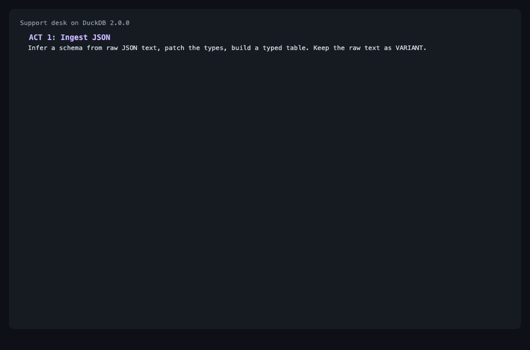

# DuckDB 2.0 demo

Runnable examples for DuckDB 2.0 "Cinnamon Teal" (released 2026-10-21), run live against `duckdb==2.0.0`. One support-desk story with eight acts, and four stand-alone recipes. Tested on macOS arm64 with Python 3.12. Unofficial, not affiliated with DuckDB Labs.



```
make demo                    # the support-desk story
make demo ARGS="4 5"         # chosen acts
make recipes                 # the four recipes
make recipes ARGS="2"        # one recipe
```

## Run it

Needs Python 3.11 or newer (the `duckdb` 2.0 wheels require it) and `make`. `make` creates a `.venv`, installs `requirements.txt` and runs. If `python3` is older, use `make PYTHON=python3.12`. The first run downloads the `duckpgq`, `typed_ai`, `ducklake` and `quack` extensions, so it needs internet.

The agent-mode parts need the 2.0 CLI, because a 1.x CLI has no agent mode. Download it from the [v2.0.0 release](https://github.com/duckdb/duckdb/releases/tag/v2.0.0) and set `DUCKDB_CLI=/path/to/duckdb`. Without it those parts are skipped.

## Support desk

Tickets arrive as JSON and go through eight steps.

| Act | What it does | Features |
|---|---|---|
| 1. Ingest JSON | Loads raw text, infers a schema, patches the types and builds a typed `tickets` table. The raw text stays in a `VARIANT` column. | Python appender, `json_transform`, `VARIANT` |
| 2. Triggers | A row trigger writes one audit row per ticket. A statement trigger on `inbox` counts the rows in each batch. | `CREATE TRIGGER` |
| 3. Quack server | Serves the database. Three clients append at once and a dashboard queries it remotely. | Quack, `CONNECT` |
| 4. Similarity search | Finds the closest solved ticket for each open ticket over a toy keyword embedding. | `NEAREST` join, `lambda` |
| 5. Graph queries | Matches customer, opened ticket, duplicate of the root outage ticket. | DuckPGQ, extensible parser |
| 6. Model scoring | Asks a model a yes/no question per ticket. A dry run prices the query and `typed_budget_usd` caps spend. | `typed_ai` extension |
| 7. Snapshots | Writes daily summaries to a DuckLake table and reads it as of the first load. | DuckLake, `AT (VERSION => n)` |
| 8. CLI agent mode | Sends a valid query and a typo through the CLI. | `duckdb -agent` |

Act 6 is a dry run by default and calls no model. `DEMO_LIVE=1` makes real calls with `TYPESAFE_API_KEY` and costs cents.

## Recipes

| Recipe | What it shows | Features |
|---|---|---|
| 1. Ship a dataset as one tiny file | 2M events as Parquet in `europe/` and `americas/` folders, shared through a 268 KB read-only catalog. | `PARTITION_PATH`, `ORDER_BY`, shredded `VARIANT`, read-only views |
| 2. Live KPI counter | A statement trigger logs each batch. Four writers append over Quack while three dashboards watch the total climb. | Triggers, Quack |
| 3. Safe for AI agents | A plain view leaks a hidden maximum salary through column statistics. A secure view does not. The CLI caps what an agent reads. | `SECURE VIEW`, agent mode |
| 4. Undo a bad data load | A bad batch lands in a DuckLake table. The table is read and restored as of the earlier snapshot. | DuckLake snapshots |

## Gotchas

- `x -> x + 1` lambdas are an error. Write `lambda x: x + 1`.
- Python relations have no `fetchone()`. Use `con.execute(sql).fetchone()`.
- A file written by 2.0 cannot be opened by 1.5.5. Upgrade on copies.
- Quack handles parallel inserts. Updates to one row from 8 clients conflicted (48 of 200 in one run) and need a retry loop, so recipe 2 only appends. The server token must be at least 4 characters.
- Triggers have no `UPDATE ... FOR EACH ROW`. Row and statement triggers cannot share a table, and `MERGE INTO` is refused on a table that has triggers.
- DuckPGQ parses only after `SET active_grammar_extensions = ['duckpgq']`, and a pattern edge needs a name: `-[e:knows]->`.
- On 2026-10-28 (macOS arm64) the `ai`, `duckdb_mcp`, `duckpgq` and `typed_ai` extensions install and load. `jev` and `quackformers` have no download, and `faiss` downloads but fails to load.
- Agent mode, in DuckDB's own benchmark: the model read 59% fewer tokens of query output. That is about 0.5% of total input, so cost and runtime did not change. [Source](https://duckdb.org/2026/10/09/agent-mode).

For anything beyond a demo, put a TLS-terminating reverse proxy in front of Quack, as the release notes advise. Numbers come from one laptop. Release: [Announcing DuckDB 2.0.0 LTS](https://duckdb.org/2026/10/21/announcing-duckdb-200).

MIT licensed. See [LICENSE](LICENSE).
